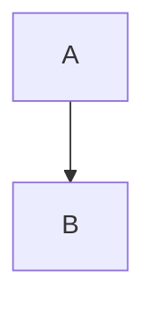

# Wizard Note

个人算法笔记站。一套完全自己写的前端（Astro + Tailwind v4）。

**线上**：https://tt3n723.github.io/

---

## 目录结构

```
src/
├── content/blog/          ← 文章都放这，**文件名就是 URL**
│     01-基础.md   →   /blog/01-基础/
│     _draft.md    →   下划线开头 = 草稿，不会被构建
├── consts.ts              ← 站名、描述、作者、导航栏、每页篇数、全站色相
├── config-sakura.ts       ← 樱花特效参数
├── data/
│     music.ts             ← 歌单（歌名、作者、封面、mp3 路径）
│     lqips.json           ← 封面占位色，**脚本生成，不要手改**
├── components/            ← 导航栏 / 头图 / 文章卡 / 目录 / 搜索 / 音乐播放器…
├── layouts/
│     BaseLayout.astro     ← 所有页面的骨架（head、主题初始化、脚本启动）
│     BlogPost.astro       ← 文章页骨架（正文板 + 右侧目录）
├── pages/                 ← 路由，一个文件一个页面
├── plugins/               ← 四个 markdown 插件（见下）
├── scripts/               ← 每个功能一个文件，由 BaseLayout 统一启动
├── styles/global.css      ← **全站所有样式**（约 2400 行，没有第二处）
└── workers/sakura.worker.ts  ← 樱花在 Worker 里跑，不占主线程

public/
├── img/               ← 封面原图（详情页头图用，不压缩）
│     card/            ← 首页预览图 640×360，**脚本生成**
├── music/             ← 歌单 mp3
├── favicon.svg        ← 标签页图标（死亡圣器，跟随浏览器明暗）
└── apple-touch-icon.png  ← iOS 主屏图标（不透明，iOS 不支持 alpha）

scripts/
├── generate-lqips.mjs    ← 生成封面占位色（pnpm build 会自动跑）
├── generate-covers.mjs   ← 生成首页预览图（**手动跑**，见下）
└── clean.mjs             ← 清缓存
```

---

## 加一篇新文章

### 1. 建文件

在 `src/content/blog/` 下新建 `.md`，**文件名就是 URL**：

```
19-新专题.md    →    /blog/19-新专题/
```

### 2. 写 frontmatter

```yaml
---
title: "算法笔记 19｜新专题"      # 必填。会显示在头图和浏览器标签上
description: "一句话概括，显示在首页文章卡上"
pubDate: 2026-06-01              # 必填，决定排序
updatedDate: 2026-06-15          # 可选
tags: [图论, DP]                  # 可选
categories: [Algorithm]          # 可选，第一个会显示在卡片上
cover: /img/19.jpg               # 可选，不写就没有封面图
draft: false                     # 可选
---
```

> 想写草稿又不想删掉内容？把文件名改成 `_xxx.md`（下划线开头）—— 会被静默忽略，连构建都不参与。

### 3. 封面图（如果用了 cover）

```bash
# 把原图放进 public/img/19.jpg，然后生成首页预览图：
node scripts/generate-covers.mjs
```

**这一步不能忘** —— 首页文章卡用的是 `public/img/card/19.webp`（640×360），没生成的话卡片是空白。

两个尺寸的分工：

| | 用在哪 | 大小 | 压缩 |
|---|---|---|---|
| `public/img/19.jpg` | 详情页头图 | 原始尺寸 | **不压缩** |
| `public/img/card/19.webp` | 首页卡片 | 640×360 | 有损 |

### 4. 本地看效果

```bash
pnpm dev          # 改文章热更新
pnpm build        # 生成 lqip + 构建 + 建搜索索引
pnpm preview      # 预览构建结果
```

---

## 文章里能写什么

### 数学公式

行内 `$O(n\log n)$`，独立成行用 `$$`。KaTeX 渲染，**长公式会自动换行**（不会横向溢出）。

### 代码块

````
```cpp
int main() { return 0; }
```
````

自动高亮（Shiki，深浅两套主题）+ 三色点窗口外观 + 右上角复制按钮。**行号可选**。

### 折叠块 —— 最常用

````
:::details[题解（C++）]
这里写内容，可以放代码块
:::
````

403 个题解全用这个。默认收起，点标题展开。

### 提示框

````
:::tip[小技巧]
内容
:::
````

五种：`tip` / `note` / `important` / `warning` / `danger`，颜色从绿到红。

### 标签页

````
:::tabs
::tab[递归写法]
内容一
::tab[迭代写法]
内容二
:::
````

### 链接卡

````
:::link[CSES Problem Set]{href="https://cses.fi/problemset/"}
简介文字（可省略）
:::
````

### 栅格（并排对比）

````
:::grid{cols=2}
::cell
左边
::cell
右边
:::
````

移动端自动变成上下排列。

### 步骤 / 时间线

````
:::steps
::step[第一步]
说明
::step[第二步]
说明
:::
````

把 `steps` 换成 `timeline` 就是时间线样式（方形节点）。序号和竖线是纯 CSS，零 JS。

### 行内剧透

` :spoiler[文字] ` —— 默认涂黑，鼠标移上去才显示。适合「先自己想，再看提示」。

### 图片（正文插图）

**放哪**：`public/img/posts/` 下，随便命名。

```
public/img/posts/binary-lifting.png
```

**怎么写**：

```

```

**不需要跑任何脚本** —— 放进去就能用。

三个自动行为：

- `alt` 文字自动变成图下方的**题注**，不用手写 caption
- 点图片**放大**（灯箱，支持左右键在同篇文章的图之间切换）
- 按正文宽度自动缩放，不会溢出

> ⚠️ **别直接丢进 `public/img/` 顶层** —— 那里是放封面的，两个脚本会把它当成封面去生成预览图和占位色，多出一堆没用的文件。

#### 正文图片 vs 封面图 —— 别搞混

|  | 封面图 | 正文图片 |
|---|---|---|
| **放哪** | `public/img/47.jpg` | `public/img/posts/xxx.png` |
| **要不要跑脚本** | **要** → `node scripts/generate-covers.mjs` | **不要** |
| **怎么引用** | frontmatter `cover: /img/47.jpg` | 正文 `` |
| **格式建议** | JPEG（源图，不压缩） | WebP / PNG（体积小） |
| **出现在哪** | 首页卡片 + 详情页头图 | 正文里面 |
| **有加载占位吗** | 有（先显示那张图的纯色块） | 没有（网慢会先空一块再跳出来） |

> 为什么封面必须跑脚本：首页卡片用的**不是原图**，而是单独的 `public/img/card/47.webp`（640×360）。不跑脚本那张卡片就是空白。

> 正文图片没有占位色是已知的小遗憾。自己看的话影响不大；真要在意，得改 `generate-lqips.mjs` 让它也扫 `posts/` 目录。

### Mermaid 图表

````

````

**滚到眼前才渲染**，而且只有页面里真有图表时才加载那 1.4 MB 的 ELK 引擎。

---

## 改站点

### 站名 / 首页标语 / 作者

`src/consts.ts`：

```ts
SITE_TITLE      导航栏左上角 + 浏览器标签 + RSS
HOME_TITLE      首页头图那行大字
HOME_SUBTITLE   首页头图副标题（**当前停用**，想恢复见文件注释）
SITE_DESCRIPTION 给搜索引擎和分享卡片用
SITE_AUTHOR     关于页标题 + 页脚
NAV_LINKS       导航栏项目
POSTS_PER_PAGE  每页几篇
SITE_HUE        全站默认色相（0-360，265 = 靛蓝）
```

### 配色

配色是 **OKLCH + 一个色相变量**驱动的：

- 导航栏的设置面板里能调**主题色相**（9 个预设 + 滑杆）和**纸面色调**（6 种：默认/暖纸/护眼绿/雾青/藕荷/纯灰）
- 这两个是**独立**的：换了暖纸，主题色仍然可以随便调
- 想改默认值 → `src/styles/global.css` 顶部的 `--hue` 和各 `--paper-*`

### 歌单

`src/data/music.ts` —— 加一首就加一条，mp3 放 `public/music/`。

### 樱花特效

`src/config-sakura.ts` —— 花瓣数量/大小/速度，还有用的图片路径。默认关闭，设置面板里开。

### 样式

**全站样式都在 `src/styles/global.css`（约 2400 行）**，没有第二处。

几个容易找错位置的：

| 想改 | 去哪 |
|---|---|
| 导航栏（含毛玻璃、设置面板） | `src/components/Header.astro` 的 `<style>` 块 |
| 头图 | `src/components/Banner.astro` 的 `<style>` 块 |
| 目录 | `global.css` 搜 `.toc-` |
| 文章卡 | `global.css` 搜 `.index-card` |
| 代码块 | `global.css` 搜 `.code-block` |

> ⚠️ Astro 的 `<style>` 是**作用域隔离**的 —— `Header.astro` 里写的样式只作用于 Header 组件内部，想在别的组件里覆盖它是没用的。

---

## 发布

```bash
pnpm build          # 必须用这个，不要用 npx astro build（会漏掉搜索索引）
git add -A
git commit -m "写清楚改了什么"
git push            # GitHub Actions 自动构建并部署
```

**`pnpm build` = 生成 lqip → astro build → pagefind 建索引**。
用 `npx astro build` 跳过 pagefind，搜索会返回 0 条结果。

Actions 在 `.github/workflows/deploy.yml`，推 `main` 或 `master` 都会触发。

---

## 踩过的坑

这些都是实际调试出来的，记下来免得重犯。

### 构建突然失败，先看 `dist` 有没有被占着

预览服务器开着的时候跑构建，可能写不进 `dist`。先关预览再构建。

### `<ClientRouter />` 会抹掉 `<html>` 上的 class

客户端路由切换会把 `<html>` 的属性重置，所以 `dark`、`js` 这些 class 会丢。每个脚本都必须在 `astro:page-load` 里重新初始化，不能只在 `DOMContentLoaded` 里跑一次。

### 半透明浅色叠在像素画头图上必然脏

试过很多次不同透明度，都救不了 —— 高饱和的像素画透过浅色层会混出一层脏色。要么用**不透明实底**，要么用**深色**。

### `content-visibility` 的 `contain-intrinsic-size` 必须匹配真实高度

给折叠代码块用 260px 占位（实际收起后只有 53px），60 个块让整页虚高 11,059px，第一次滚动滚动条会猛跳。

正确做法：把规则加在**外层容器**（`.fold-code`）上，占位值按收起高度 53px 定，而且 `auto` 关键字不能少 —— 它记住真实高度。

### KaTeX 的 `font-display` 只能是 `block`

改成 `swap` 会先用错误字体排一遍再重排，更糟。正确的解法是**预加载字体**（文章页有 5 个 `<link rel="preload">`），让字体和 HTML 同时开始下载。

### 模糊缩略图当占位会「吓人」

把封面缩到 20×20 当 LQIP，人物图会糊成「认得出轮廓又看不清脸」的形状，落在恐怖谷里。所以退回了纯色渐变。

### 音乐播放器的音量要区分「没存过」和「存了 0」

`Number(localStorage.getItem(KEY))` 在 key 不存在时返回 `0`，滑块会显示 0% 而不是 70%。必须先判断 `stored === null`。

---

## 致谢

- 视觉参考：[Firefly](https://github.com/Cuteleaf/Firefly)（导航栏毛玻璃、列表布局）
- 旧站：[hexo-theme-fluid](https://github.com/fluid-dev/hexo-theme-fluid)（正文板、文章卡语言）
- 技术栈：[Astro](https://astro.build) · [Tailwind CSS v4](https://tailwindcss.com) · [KaTeX](https://katex.org) · [Shiki](https://shiki.style) · [Pagefind](https://pagefind.app)
