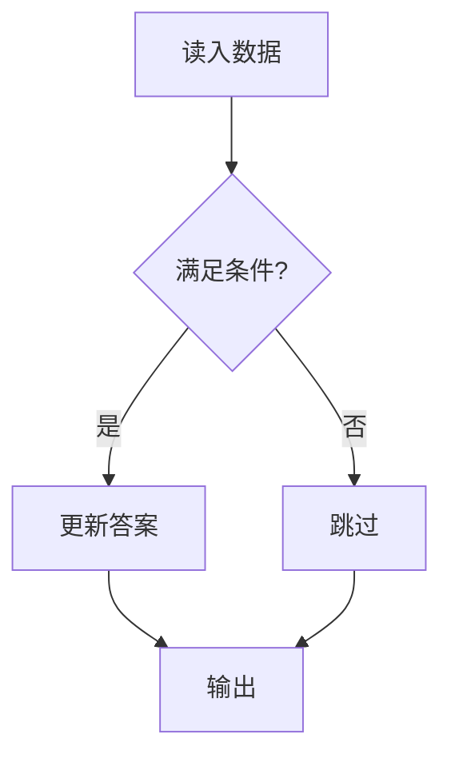
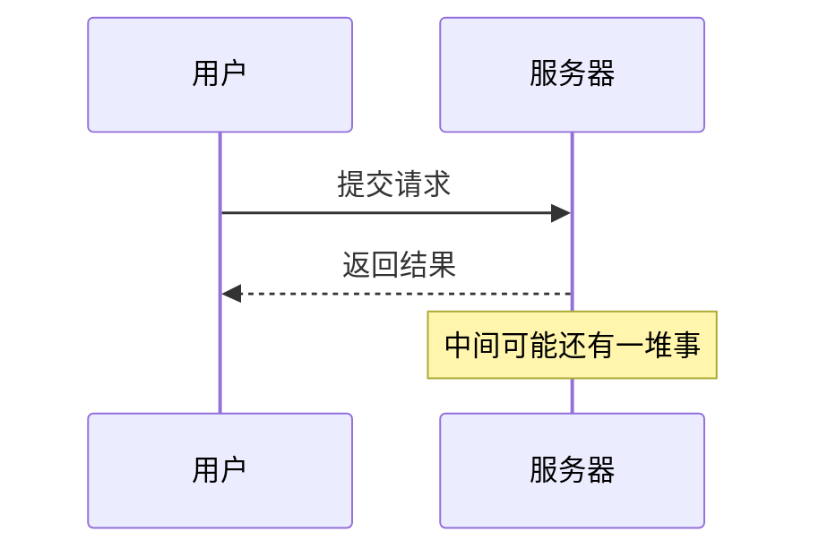
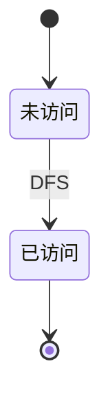

这一页是本站的**样式基准**：所有能在文章里用的东西都在这儿出现一次。
改完 CSS 之后回来扫一眼，就知道有没有把旧元素弄坏。

> 语法说明：下面这些彩色框、折叠块、标签页都是 **markdown 指令**写的，
> 不需要 import 任何组件，普通 `.md` 文件直接就能用。写法见每一节开头。

## 一、文本

普通段落文字。**加粗**、*斜体*、***粗斜体***、~~删除线~~、`行内代码`、
[站内链接](/about)、[站外链接](https://cses.fi/problemset/)。

行内公式混排在中文里：把区间 $[l, r]$ 的中点取作 $m = \lfloor (l+r)/2 \rfloor$，
递归深度是 $O(\log n)$，总复杂度 $O(n \log n)$。

### 无序列表

- 第一项
- 第二项
  - 嵌套项
  - 再来一个
- 第三项

### 有序列表

1. 读入 $n$ 个数
2. 排序
3. 输出

### 任务列表

- [x] 迁移文章
- [x] 数学公式
- [ ] 标签页
- [ ] 归档页

## 二、代码块

行内的 `vector<int>` 长这样；下面是块级代码。

```cpp
#include <bits/stdc++.h>
using namespace std;

int main() {
    ios::sync_with_stdio(false);
    cin.tie(nullptr);
    int n;
    cin >> n;
    cout << n * 2 << '\n';
    return 0;
}
```

其他语言也自动高亮：

```bash
pnpm build && pnpm preview
```

```python
def solve(n: int) -> int:
    return n * n
```

## 三、引用与表格

> 生活的90%都取决于你如何对待！
>
> ——Anna

| 算法 | 时间复杂度 | 空间复杂度 |
| --- | --- | --- |
| 归并排序 | $O(n \log n)$ | $O(n)$ |
| 快速排序 | 平均 $O(n \log n)$ | $O(\log n)$ |
| 堆排序 | $O(n \log n)$ | $O(1)$ |

## 四、公式

行内公式写成 `$...$`，比如 $O(n \log n)$、$n \le 2 \times 10^5$、$k^{\text{循环数}}$。
行内公式的行距不会把段落撑高。

块级公式用 `$$` 单独成段：

$$
f(x) = \sum_{i=0}^{n} y_i \prod_{j \ne i} \frac{x - x_j}{x_i - x_j}
$$

**长公式会自动横向滚动**，不会把页面撑破（Firefly 也是这么处理的）：

$$
\text{ans} = \sum_{i=1}^{n} \sum_{j=1}^{m} \left( \frac{a_i \cdot b_j}{\gcd(a_i, b_j)} \right)
+ \sum_{k=1}^{p} \binom{n+k-1}{k} \cdot \left\lfloor \frac{\log_2 (x_k + y_k)}{1 + \sqrt{z_k}} \right\rfloor
$$

化学式也支持（KaTeX 的 mhchem 扩展）：$\ce{2H2 + O2 -> 2H2O}$

## 五、提示框

写法：`:::tip[标题]` … `:::`，类型有 tip / note / info / important / warning / danger / caution。

:::tip[小技巧]
把 `ios::sync_with_stdio(false)` 和 `cin.tie(nullptr)` 写在 `main` 开头，
输入输出速度能提升好几倍。
:::

:::note[注意]
下标从 0 开始还是从 1 开始，是这类题最常见的错误来源。
:::

:::important[重要]
$n \le 2 \times 10^5$ 时 $O(n \log n)$ 能过，$O(n^2)$ 一定超时。
:::

:::warning[易错点]
数组开小了不会报错，只会访问到别的内存，表现为莫名其妙的 WA。
:::

:::danger[不要这样做]
不要在 `solve()` 里重新定义全局变量，多组数据时它会保留上一组的值。
:::

## 六、折叠块

写法：`:::details[标题]` … `:::`。这就是全站 403 个题解折叠块用的语法
（从旧的 Hexo `` 迁移过来，视觉完全一致）。

:::details[题解（C++）]
读入后逐项判断，遇到奇数就乘 3 加 1，偶数就除以 2，直到变成 1。

```cpp
void solve() {
    long long n;
    cin >> n;
    while (n != 1) {
        cout << n << ' ';
        n = (n % 2 == 0) ? n / 2 : n * 3 + 1;
    }
    cout << 1 << '\n';
}
```
:::

## 七、标签页

写法：外层 `:::tabs`，里面用 `::tab[名字]` 分隔，**不需要嵌套更多的冒号**。

:::tabs
::tab[递归写法]
```cpp
int power(int a, int b) {
    if (b == 0) return 1;
    int half = power(a, b / 2);
    return b % 2 ? half * half * a : half * half;
}
```
::tab[迭代写法]
```cpp
int power(int a, int b) {
    int res = 1;
    while (b) {
        if (b & 1) res *= a;
        a *= a;
        b >>= 1;
    }
    return res;
}
```
::tab[对比]
| | 递归 | 迭代 |
| --- | --- | --- |
| 空间 | $O(\log n)$ 栈 | $O(1)$ |
| 可读性 | 更直观 | 需要理解二进制拆分 |
:::

## 八、链接卡

写法：`:::link[标题]{href="地址"}` … `:::`。

:::link[CSES Problem Set]{href="https://cses.fi/problemset/"}
300 道题的题库，从入门到进阶都有，全部可以在线评测。
:::

站内链接会自动换一套样式（左侧实心竖线 + → 箭头，点击在当前页打开）：

:::link[Go 语言入门笔记]{href="/blog/begin/"}
从零开始的 Go 语法笔记，包含并发、接口和标准库的常用写法。
:::

## 九、栅格

写法：外层 `:::grid{cols=2}`，用 `::cell` 分隔各格。

:::grid{cols=2}
::cell
**左边这一格**

可以用来并排对比两种写法、两张图、或者复杂度分析。
::cell
**右边这一格**

移动端会自动变成上下排列。
:::

## 十、剧透（行内）

写法：`:spoiler[文字]`。默认涂黑，鼠标移上去才显示——适合"先自己想，再看提示"。

:::tip[试试]
这题的关键是 :spoiler[把区间 DP 的转移写成前缀和优化]，想不出来就先别点开。
:::

## 十一、步骤

写法：外层 `:::steps`，用 `::step[标题]` 分隔。序号和竖线全是 CSS 画的，零 JS。

:::steps
::step[读入并按左端点排序]
这样后面扫描时不会漏掉跨区间的组合。
::step[扫描右端点]
维护当前最优左端点，遇到更优就更新。
::step[输出答案]
时间复杂度 $O(n \log n)$，瓶颈在排序。
:::

## 十二、时间线

写法：外层 `:::timeline`，同样用 `::step[标题]` 分隔，视觉上换成方形节点。

:::timeline
::step[2025-12 写完了前 11 篇笔记]
覆盖基础、数据结构、图论、DP、字符串、数论、组合、线代、几何。
::step[2026-01 开始刷 CSES]
按专题刷，每篇笔记 40–80 题，全部折叠起来。
::step[2026-05 迁移到 Astro]
从 Hexo 搬到这套自己写的站，顺便重做了代码块和目录。
:::

## 十三、图片

图片的 `alt` 会自动变成下面的**题注**（不用手写 caption，写 alt 就够了）：


**点图片可以放大**——点背景或按 ESC 关闭，左右方向键在文章内的图片之间切换。
不想被点击的图，给它加个 `no-lightbox` 类就行。

## 十四、图表（Mermaid）

流程图：



时序图：



状态图：



图表是**滚到眼前才渲染**的，而且只有页面里真有图表时才会去加载 Mermaid——
所以没有图表的文章完全不受影响。配色会跟着明暗主题走。

## 十五、脚注式的补充

如果某段太长又不想删，就用折叠块包起来（见第六节）。
这一页本身也是 `/lab` 那个 A/B 展台的"markdown 层"搭档。
